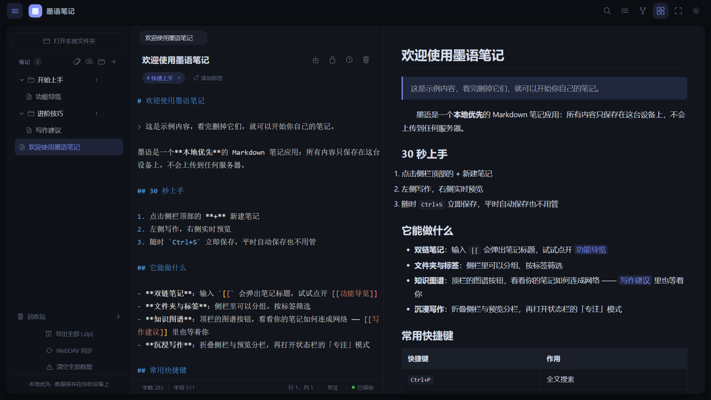
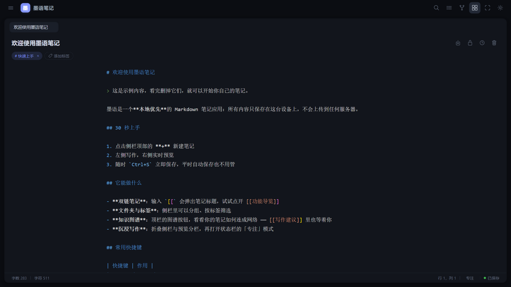

# 墨语笔记（Moyu Notes）

一个**本地优先**的 Markdown 笔记应用，追求 Typora 式的沉浸写作体验。「墨」取自笔墨，「语」取自言语——用文字记录思想。

**在线体验**（GitHub Pages，笔记数据仅存于你的浏览器本地）：<https://li-ziyin.github.io/moyu-notes/>

## 预览

| 编辑与实时预览 | 知识图谱 | 沉浸写作 |
|---|---|---|
|  |  |  |

## 功能

**写作**

- Monaco 编辑器（VS Code 同款内核，自托管）+ markdown-it 实时预览
- 专注模式：打字机滚动、当前行高亮；状态栏实时字数与保存状态
- 智能续行、8 个 Markdown 快捷键、Ctrl+S 即时保存、拖拽导入 .md
- 明暗双主题跟随系统，多标签页编辑，全屏与可折叠布局，移动端适配

**知识管理**

- 多级文件夹与标签筛选
- 双链笔记 `[[标题]]` 与反向链接，知识图谱（Canvas 力导向）可视化
- 全文搜索：Ctrl+P 呼出，FlexSearch 中文二元分词，标题与内容高亮
- 图片粘贴即存（asset:// 引用）；单篇与打包导入导出
- 加密笔记：AES-GCM + PBKDF2（原生 Web Crypto），锁定显示密文

**数据安全与同步**

- 双模式存储：IndexedDB / File System Access API 本地文件夹直读 .md
- 自动快照（每 5 分钟保留 20 个）+ 回收站，误操作可找回
- WebDAV 多设备同步：新者胜策略，覆盖前强制快照
- 外部变更检测、持久化存储申请、超期未备份静默提醒
- 预览经 DOMPurify 消毒，导入与同步内容一律按不可信处理

**工程与体验**

- 虚拟滚动：数千篇笔记滚动流畅；首屏 JS ~120KB（gzip 39KB）
- PWA：可安装、离线可用；移动端窄屏自动抽屉布局
- Vitest 35 项单元测试；GitHub Actions 类型检查 + 构建并部署 Pages

## 技术栈

Vue 3（组合式 API）+ TypeScript + Vite · Pinia · Monaco Editor（自托管）· markdown-it · Dexie（IndexedDB）+ File System Access API · FlexSearch · Web Crypto（AES-GCM 256 + PBKDF2）· Canvas 力导向图谱（零依赖）

## 快速开始

```bash
npm install
npm run dev      # 开发服务器
npm run build    # 类型检查 + 生产构建
npm test         # Vitest 单元测试
```

> 本地文件夹模式需 Chrome / Edge 86+（File System Access API）。部署：仓库 Settings → Pages → Source 选 GitHub Actions，推送 main 自动构建发布。

## License

MIT
